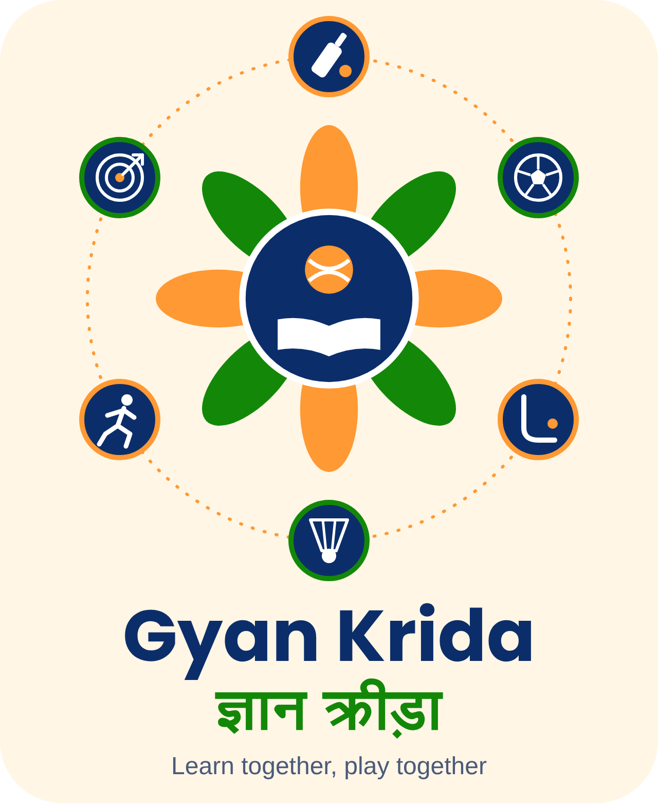

# Gyan Krida – Gramin Chhatra Sahayata

<p align="center"></p>

> **Learn together, play together.** Free notes, mentor guidance, scholarship links and sports pathways for rural students, in one place.

**Live demo:** https://krishnar9907-wq.github.io/gyan-krida/
**License:** MIT

> 🚧 **Prototype for feedback.** All library items and mentor profiles are sample content. Nothing is stored on a server.

## Problem

Students in rural India often lack easy access to study material, senior guidance, trustworthy scholarship information and sports pathways. Information is scattered, mostly in English, and hard to use on a slow phone connection.

## Features

| Module | What it does |
|---|---|
| **E-Pustak Daan (Library)** | Search notes/PDFs by level (School / College / Competitive), save favourites, voice search, share a resource (stored on the device only) |
| **Margdarshan (Mentors)** | Browse sample mentor profiles and send a mentor request (prototype) |
| **Opportunity Finder** | Links to official scholarship and opportunity portals only |
| **Sports Hub** | Pick a sport and stage to get a starter checklist; links to Khelo India, SAI and Fit India |
| **Dashboard** | Summary of library items, saved items, scholarships and sports checklist |
| **7 languages** | English, Hindi, Punjabi, Marathi, Bengali, Tamil, Telugu |
| **AI Gem, streak and Learning Zone** | Study helper that explains topics simply (works offline with built-in topics), daily study streak with XP and badges, daily quiz, focus timer, NCERT textbook finder and links to free courses |
| **WhatsApp feedback and share** | Feedback is sent by the user via WhatsApp; no backend needed |

## Tech stack

- Plain **HTML + CSS + JavaScript** in a single `index.html` (no build step; Tailwind is loaded from a CDN)
- **localStorage** for saved items, user-added resources and the sports checklist
- **Service worker + web manifest** so the app works offline and can be installed on a phone
- Hosted on **GitHub Pages**

## Getting started

### Run locally

```bash
git clone https://github.com/krishnar9907-wq/gyan-krida.git
cd gyan-krida

# Option 1: just open the file
open index.html            # macOS (use xdg-open on Linux, or double-click on Windows)

# Option 2: serve it locally (recommended)
python3 -m http.server 8000
# then visit http://localhost:8000
```

### Environment variables

**None.** The app has no backend, API keys or secrets.

### Deploy

Push to `main`, then in GitHub go to **Settings → Pages → Deploy from branch → main / root**.

## Repository structure

```
gyan-krida/
├── index.html                      # the whole app
├── gyankrida-extras.js             # AI Gem, streak, quiz, timer, Learning Zone
├── gyankrida-ncert.js              # NCERT textbook finder
├── sw.js                           # service worker (offline mode)
├── manifest.json                   # makes the app installable
├── icon.svg, icon-192.png, icon-512.png, logo.png
├── worker.js                       # optional Cloudflare Worker for real AI answers
├── data/sample.json                # sample library, mentors, opportunities, sports data
├── docs/ARCHITECTURE.md            # technical design document + diagrams
├── tests/validate_sample_data.py   # automated sample-data checks
├── TESTING.md                      # manual test cases
├── INSTALL.md                      # how to add AI Gem + Learning Zone
├── LICENSE
└── README.md
```

## Sample data and tests

 - Sample data: [sample.json](sample.json)
    - Run automated checks: python3 validate_sample_data.py.
      - Manual test cases: [`TESTING.md`](TESTING.md)

## Architecture

See [ARCHITECTURE.md](ARCHITECTURE.md) for diagrams and design decisions.

## Privacy and safety

- No accounts, no server, no analytics. Data stays in the user's browser.
- Feedback is sent by the user through WhatsApp; the app never stores it.
- Users are warned not to share phone numbers, addresses or documents.
- Scholarship and sports links point to official government portals; users are told to confirm dates and eligibility there.
- Users are told not to upload copyrighted books.

## Limitations (prototype)

- The first visit needs internet; after that the app works offline (AI Gem uses its built-in topics when offline).
- Library items and mentors are sample content; real mentors would need verification before going live.
- Added resources and saved items live only on the user's device.
- Translations should be reviewed by native speakers.

## Roadmap

1. Verified mentor onboarding and a moderated shared library (backend)
2. Bundle the styling locally (no CDN) so even the very first visit works fully offline
3. Native-speaker review of all 7 languages
4. Live scholarship deadline feed from official sources

## Contributing

Issues and pull requests are welcome. Please do not add copyrighted material to the sample data.

## License

Released under the [MIT License](LICENSE).
